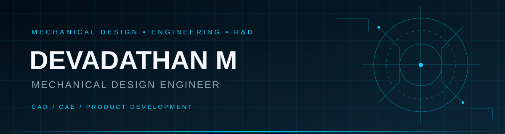

<!-- ===================================================== -->
<!-- DEVADATHAN M | MECHANICAL DESIGN ENGINEER -->
<!-- GitHub Profile README -->
<!-- ===================================================== -->

<!-- HERO BANNER -->
<p align="center">
  
</p>

<h3 align="center">
  Mechanical Design Engineer | CAD | CAE | Product Development
</h3>

<p align="center">
  <a href="https://devadathanm.github.io/">
    
  </a>
  <a href="https://www.linkedin.com/in/devadathanm">
    
  </a>
  <a href="mailto:9497534004devan@gmail.com">
    
  </a>
  <a href="https://github.com/devadathanm">
    
  </a>
</p>

<p align="center">
  
</p>

---

## ⚙️ ENGINEERING PROFILE

```text
NAME        : Devadathan M
ROLE        : Mechanical Design Engineer
FOCUS       : CAD | CAE | Product Development
INTERESTS   : Robotics | EV | Aerospace | R&D
APPROACH    : Design → Analyze → Improve → Build
```

I am a Mechanical Design Engineer interested in transforming engineering concepts into practical products through CAD modelling, engineering analysis, and product development.

I enjoy working on mechanical systems, design optimization, simulation, and innovative engineering solutions.

- Mechanical design and 3D modelling
- Engineering simulation and structural analysis
- Product development and concept design
- Manufacturing-oriented design
- Continuous technical learning

---

## 🛠️ ENGINEERING TOOLKIT

### CAD / 3D DESIGN

<p>
  
  
  
  
  
  
</p>

### CAE / SIMULATION

<p>
  
  
  
</p>

### MANUFACTURING / DESIGN TOOLS

<p>
  
  
  
  
</p>

### PROGRAMMING / DEVELOPMENT

<p>
  
  
  
  
  
  
</p>

---

## 🚀 FEATURED ENGINEERING PROJECTS

### 01 | Cardamom Cleaning Machine

**Portable agricultural processing concept**

- Developed a portable auger-based cardamom cleaning machine concept.
- Focused on practical cleaning and material handling.
- Considered water conservation and usability.

### 02 | Steaming & Folding Machine

**Automated garment processing**

- Mechanical concept and CAD development.
- Focused on integrating steaming and folding operations.
- Included bench-level testing and design evaluation.

### 03 | 11th Go-Kart Design Challenge

**Automotive engineering**

- Worked on tubular chassis design.
- Explored steering geometry and vehicle packaging.
- Team achieved a Top 10 position.

### 04 | Electric Vehicle Challenge

**Electric mobility**

- Worked on powertrain packaging concepts.
- Explored battery enclosure design.
- Focused on mechanical integration.

<p align="center">
  <a href="https://devadathanm.github.io/">
    
  </a>
</p>

---

## 📊 GITHUB ANALYTICS

<p align="center">
  
  
</p>

<p align="center">
  
</p>

---

## 🐍 CONTRIBUTION SNAKE

<p align="center">
  
</p>

---

## 🎯 CURRENT INTERESTS

- Advanced mechanical design and engineering simulation
- Robotics and automation
- Electric vehicle engineering
- Aerospace mechanical systems
- Product design and development
- Learning Python and engineering automation

---

## ⚡ ENGINEERING MINDSET

<p align="center">
  <i>"Good engineering is not just about making something work. It is about making it work reliably, efficiently, and intelligently."</i>
</p>

<p align="center">
  
  
  
</p>

<p align="center">
  <b>Thanks for visiting my engineering space!</b>
</p>

<p align="center">
  <a href="https://github.com/devadathanm">
    
  </a>
</p>

